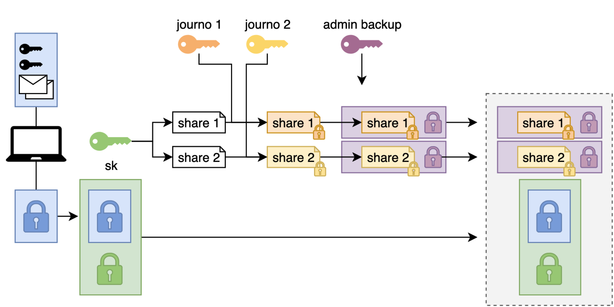
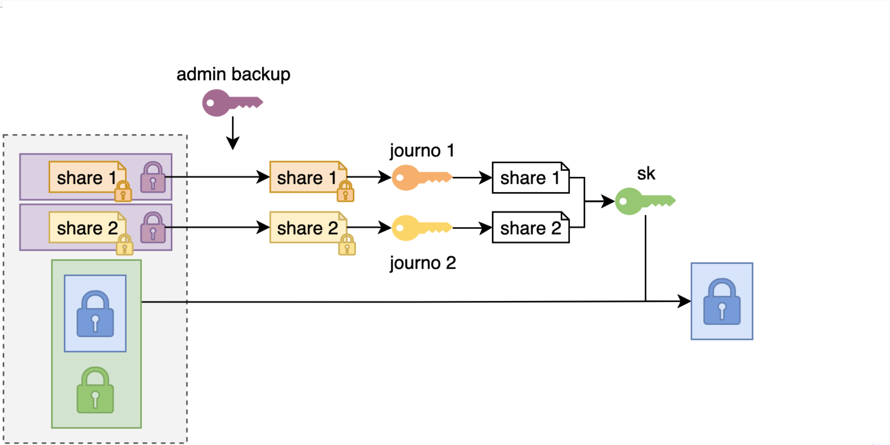

# Formal verification of CoverDrop's journalist vault backup protocol using Verifpal

⚠️ This is an experimental model created for an [applied cryptography course](https://appliedcryptography.page/).

[CoverDrop](https://www.coverdrop.org/) is a secure, anonymous system that lets sources make first contact with journalists through a news app, developed by the University of Cambridge and The Guardian.

A **journalist vault** is a database that lives on the laptop of each registered CoverDrop journalist and holds their conversations with sources and secret key material.
The journalist vault backup protocol defines how journalist vaults are securely backed up to untrusted cloud storage, and restored with the help of an admin and two other journalists who are chosen as trusted recovery contacts.
The protocol has been implemented and deployed in production since December 2025.
Most of the protocol's business logic is implemented [here](https://github.com/guardian/coverdrop/blob/main/common/src/protocol/backup.rs).

[`backup_protocol.vp`](./backup_protocol.vp) models this backup protocol to formally verify that the vault data stays confidential.

- **Backup:** Alice encrypts her vault, splits the key into 3 shares (any 2 of which recover the key) for Bob, Charlie and Duncan, wraps each share for the Admin, and signs the bundle.
- **Restore:** the Admin verifies the signature, asks two contacts to unwrap their shares, combines the shares to recover the key and decrypts the vault.

## Diagrams

The protocol is described in comments in `backup_protocol.vp`, but the following diagrams might make the process clearer:

### Creating a backup



### Restoring a backup



## Running

```sh
verifpal verify backup_protocol.vp # default: 2 sessions
verifpal verify backup_protocol.vp --sessions 1
```

## Expected results

| Query | 1 session | 2 sessions |
|---|---|---|
| `confidentiality? alice_vault_data` | pass | pass |
| `confidentiality? backup_symmetric_key` | pass | pass |
| `authentication? Alice -> Admin: encrypted_vault` | pass | **fail** |

The 2-session failure is a replay of a genuine backup signed by Alice. This is a known issue.
